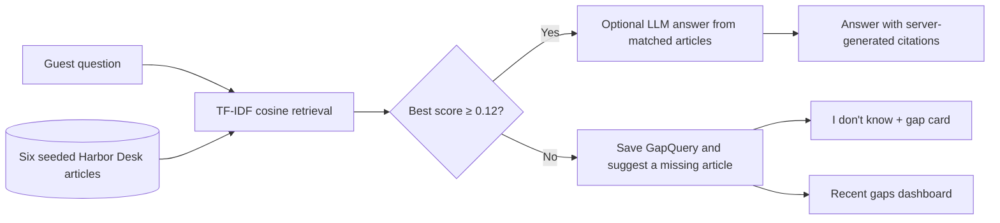

# Knowledge Gap Bot

A small, recruiter-ready support FAQ demo for fictional Harbor Desk. It answers only when the help center contains a relevant article, cites that source, and records unsupported questions as knowledge gaps instead of asking an LLM to guess.

## How it works



The retrieval threshold is documented in `config/knowledge.php` and displayed in the UI. TF-IDF weights article and question terms, then cosine similarity ranks the six seeded articles. A low score exits before the LLM interface is called. For a match, article citations are produced by the application, not generated by the model. The optional Gemini prompt is restricted to retrieved article text, uses a 12-second HTTP timeout, and falls back to the retrieved excerpt if the provider is unavailable.

## Run locally without an API key

Requirements: PHP 8.3+, Composer, Node.js 22+ and npm.

```bash
composer install
copy .env.example .env
php artisan key:generate
php -r "file_exists('database/database.sqlite') || touch('database/database.sqlite');"
php artisan migrate --seed
npm install
```

In one terminal, run `php artisan serve`; in a second terminal, run `npm run dev`. Then open `http://localhost:8000`. No account is required. SQLite is the default database. The seeder installs six fictional articles about password resets, account email, shipment tracking, order changes, delivery times, and returns. Re-running `php artisan db:seed` updates those articles without duplicating them.

When `GEMINI_API_KEY` is unset, Laravel binds `FakeLlmClient`; matched questions are answered from the retrieved article excerpt, so the app works fully offline and makes no external LLM request. To try optional Gemini generation, set `GEMINI_API_KEY` in `.env`; the default model is `gemini-2.5-flash` and can be changed with `GEMINI_MODEL`.

## Verify the AI behavior

```bash
php artisan test
```

Pest feature tests verify that an in-corpus password question returns the matching article citation; an out-of-corpus travel question creates an unanswered `GapQuery`, returns an explicit “I don't know” response with no citations, and never invokes the LLM; `FakeLlmClient` is bound in tests; and a guest can submit a question successfully.

## Stack

- Laravel 13, PHP 8.3+, SQLite
- Vue 3, Inertia, Tailwind CSS
- Deterministic TF-IDF cosine retrieval; optional Gemini behind `App\Services\Llm\LlmClient`
- Pest feature tests

## Data model

- `DocChunk`: seeded source article (`title`, `body`)
- `GapQuery`: unsupported question, best retrieval score, answered flag, and suggested article title

No real customers, personal health information, payments, or Redis are used.
